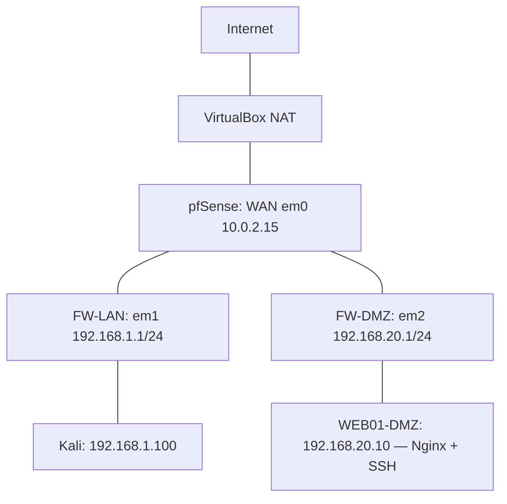
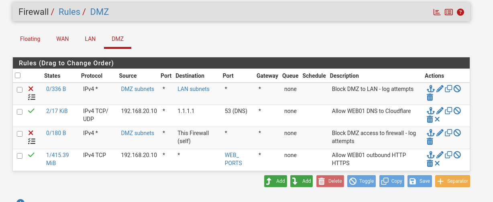

# pfSense Firewall Lab — LAN/DMZ Segmentation

**Badr Eddine Drider · Core lab completed on 1 November 2026**

A practical VirtualBox lab showing how to separate a client network from a web server, allow useful services, block unwanted connections, and explain the results using firewall logs.

The lab combines **pfSense CE, Kali Linux, Ubuntu Server, Nginx, TLS and SSH**. It runs on a Windows host with 16 GB RAM. This is a small network security project, not an EDR/XDR deployment or a production security assessment.

## What this project demonstrates

- Separate LAN and DMZ networks with pfSense as their router and firewall.
- Ordered IPv4 rules: web access from LAN, SSH from one approved client, and restricted DMZ egress.
- Blocked DMZ-to-LAN ping and blocked access to the firewall HTTPS interface, with matching logs.
- Nginx HTTP and HTTPS, including an explicit certificate trust test without curl's `-k` option.
- Automatic outbound NAT and successful outbound HTTPS from the DMZ.
- Troubleshooting based on configuration, commands and evidence rather than assumptions.

## Architecture

This diagram describes the topology; it is not a packet capture. **FW-LAN and FW-DMZ are separate VirtualBox Internal Networks, not VLANs.** The WAN uses VirtualBox NAT, so this is not a publicly hosted website.

| Machine/interface | Address | Role |
|---|---|---|
| FW01-pfSense WAN / em0 | 10.0.2.15/24, DHCP | Upstream via 10.0.2.2 |
| pfSense LAN / em1 | 192.168.1.1/24 | LAN gateway; DHCP pool .100–.199 |
| pfSense DMZ / em2 | 192.168.20.1/24 | DMZ gateway |
| CLIENT-FW-LAN / Kali eth0 | 192.168.1.100/24, DHCP | Web client and administrator |
| WEB01-DMZ / Ubuntu enp0s3 | 192.168.20.10/24, static | Nginx web server; gateway .20.1; DNS 1.1.1.1 |

## Read the lab as a lesson

1. [Build guide: what we did and why](docs/build-guide.md)
2. [Final firewall policy and rule order](docs/firewall-policy.md)
3. [Validation commands and actual results](docs/validation.md)
4. [Real screenshot evidence](docs/evidence.md)
5. [Final checkpoint and restart instructions](docs/build-checkpoint.md)

## Results at a glance

| Test | Result | Evidence level |
|---|---|---|
| Kali → WEB01 HTTP | 200 OK | Screenshot |
| Kali → WEB01 ping | Blocked | Terminal screenshot + matching LAN firewall logs |
| WEB01 → Kali ping | Blocked | Matching DMZ firewall logs; packet loss reported |
| WEB01 → pfSense DMZ address, HTTPS | Blocked | curl timeout + matching TCP SYN block logs |
| Kali → WEB01 SSH | Login successful | Operator-confirmed; rule and SSH service captured |
| Nginx TLS configuration test | Successful | Screenshot of `nginx -t` |
| Kali → WEB01 HTTPS with `--cacert` | 200 OK | Operator-confirmed; no result screenshot supplied |
| WEB01 → example.com HTTPS | 200 OK | Operator-confirmed; NAT configuration captured |

A timeout alone is not treated as proof of firewall enforcement. The negative tests above were correlated with the rules that blocked the traffic. See the validation page for exact commands and limits.

## Final DMZ rules

Read top to bottom: block LAN access; permit WEB01 DNS to 1.1.1.1; block access to the firewall itself; permit WEB01 TCP 80/443 egress. Remaining unmatched new connections are denied by the default policy.

## Scope and limitations

- Validation covers the documented **IPv4** flows. The default LAN IPv6 allow rule remains; IPv6 isolation has not been demonstrated.
- DMZ web egress has destination **Any**, with earlier LAN/self blocks. It is not a public-address-only or Ubuntu-repository-only allowlist; other private upstream destinations are not explicitly excluded.
- TLS uses a **self-signed lab certificate**. `--cacert` supplies explicit trust for one curl command; browsers do not trust it automatically. HTTP remains available; no redirect was configured.
- SSH is allowed from the observed Kali IP, which is DHCP-assigned. If that address changes, update the rule or configure a DHCP reservation. An IP rule is not user authentication.
- No claim is made of a full OS upgrade, IDS/IPS, EDR/XDR, packet-capture analysis, exhaustive port testing, or a post-TLS reboot test. These are optional extensions outside this completed core lab.
- Never publish passwords, private keys or an unsanitized pfSense configuration export.

## CV description

Built a pfSense LAN/DMZ lab with ordered IPv4 firewall rules, restricted DNS and web egress, automatic outbound NAT, Nginx HTTPS and source-restricted SSH administration; validated permitted flows and investigated blocked connections using firewall logs.
