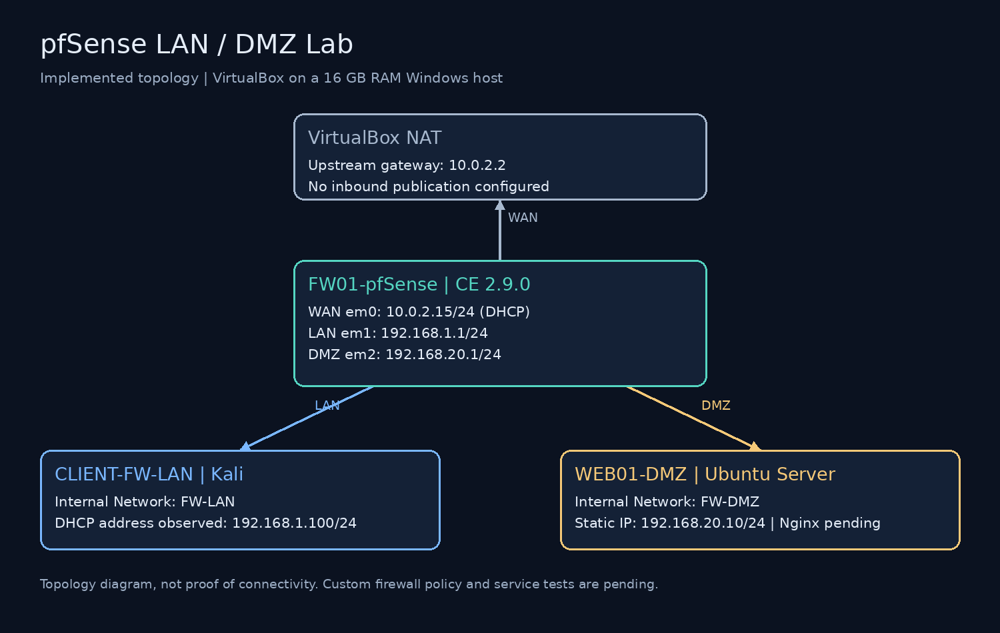
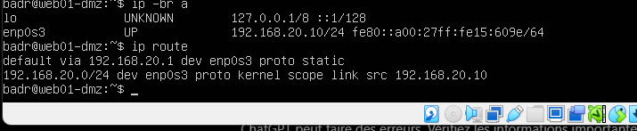
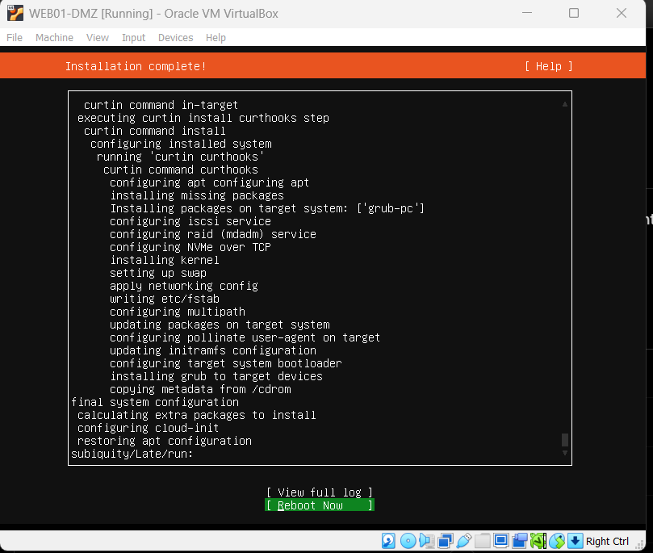
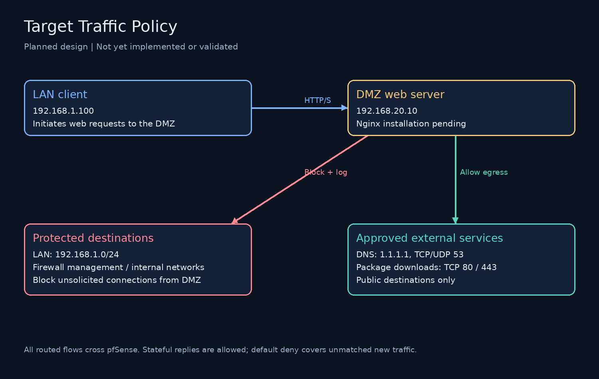
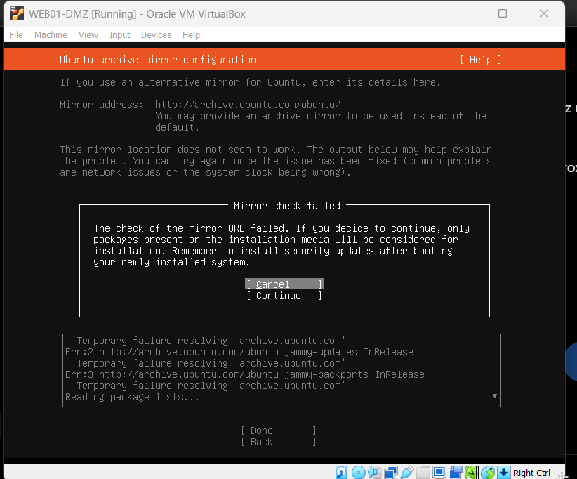

# pfSense Firewall Lab: LAN and DMZ Segmentation

A hands-on network security lab built in VirtualBox to practice firewall administration, network segmentation, controlled server egress, and evidence-based troubleshooting.

**Author:** Badr Eddine Drider  
**Status:** In progress — infrastructure installed; custom firewall policy and Nginx deployment pending.  
**Checkpoint:** 28 October 2026

## Project objective

Place an Ubuntu web server in a dedicated DMZ and use pfSense to control traffic between the LAN, DMZ, and upstream network. The final lab will demonstrate permitted web access, blocked DMZ-initiated LAN access, and the firewall logs that explain each result.

This repository distinguishes completed configuration from planned controls. It does not yet claim verified isolation, working Internet access from the DMZ, or a deployed web service.

## Architecture



| Component | Role | Network / address |
|---|---|---|
| FW01-pfSense | Router and firewall | WAN em0: 10.0.2.15/24 via VirtualBox NAT |
| pfSense LAN | Client gateway | em1: 192.168.1.1/24, Internal Network FW-LAN |
| pfSense DMZ | Server gateway | em2: 192.168.20.1/24, Internal Network FW-DMZ |
| CLIENT-FW-LAN | Kali test client | DHCP address observed: 192.168.1.100/24 |
| WEB01-DMZ | Ubuntu Server; planned Nginx host | Static 192.168.20.10/24, gateway 192.168.20.1 |

The Windows host has 16 GB RAM. pfSense and Ubuntu were configured with 2 GB RAM each; two vCPUs and a 20 GB virtual disk were requested for each. Final VM inventory should be captured before treating all hardware values as audited. Ubuntu was installed from `ubuntu-22.04.5-live-server-amd64.iso`; the installed OS version will also be recorded from the running system.

The two VirtualBox Internal Network names represent separate virtual network segments. Their names alone do not enforce the intended policy: pfSense rules and successful positive/negative tests are required. The NAT WAN is a lab upstream, not a publicly reachable production deployment.

## Progress

- [x] Install pfSense CE and access its management dashboard from the LAN.
- [x] Configure WAN, LAN, and DMZ interfaces.
- [x] Obtain a LAN client lease and verify access to the LAN gateway.
- [x] Install Ubuntu Server in the DMZ.
- [x] Verify the server static IP and default route after reboot.
- [ ] Implement and review DMZ firewall rules.
- [ ] Validate DNS and controlled outbound package access.
- [ ] Apply Ubuntu updates and install Nginx.
- [ ] Restrict LAN-to-DMZ access to approved services.
- [ ] Verify permitted traffic, blocked traffic, and stateful replies.
- [ ] Capture firewall logs and a filtered packet trace.
- [ ] Review evidence and complete final results.

## Verified server configuration

Commands executed after installation:

```bash
ip -br a
ip route
```

Observed: `enp0s3` is UP with `192.168.20.10/24`, and the default route uses `192.168.20.1`. These establish local configuration, not end-to-end connectivity.





## Target traffic policy



| Source | Destination | Service | Intended action | State |
|---|---|---|---|---|
| LAN test client | DMZ web server | TCP 80; TCP 443 after TLS configuration | Allow | Planned |
| Approved LAN administrator | pfSense management | HTTPS | Allow | Access observed; restriction audit pending |
| DMZ web server | 1.1.1.1 | TCP/UDP 53 | Allow DNS | Planned |
| DMZ web server | Public package servers | TCP 80/443 | Allow package traffic | Planned |
| DMZ | LAN | New connections, any service | Block and log | Planned |
| DMZ | Firewall management and other internal destinations | New connections | Block | Planned |
| Any unmatched source | Routed destinations | New connections | Default deny | Review and test pending |

Order matters: place internal-destination protection above broad web egress permissions. An `any` destination on TCP 443 must not accidentally expose the firewall GUI. Restrict DNS to the selected resolver. HTTP/HTTPS port rules alone do not restrict downloads to Ubuntu repositories; domain-aware restrictions would require additional design. Keep IPv6 disabled or explicitly controlled until a separate IPv6 policy is tested.

## Troubleshooting completed so far

1. **LAN client retained an old static address:** cleared stale NetworkManager address, gateway, route, and DNS settings, then reactivated DHCP. The client subsequently obtained 192.168.1.100/24.
2. **DMZ mask correction:** changed the DMZ interface from an accidental /32 to /24.
3. **Server gateway typo:** corrected 192.168.10.1 to the DMZ gateway, 192.168.20.1; the final route output confirms the correction.
4. **Ubuntu mirror DNS failure:** the installer could not resolve archive.ubuntu.com while DMZ outbound rules were not configured. Installation continued using ISO packages. The exact network cause remains to be confirmed with DNS and firewall tests; updates are still pending.
5. **Installation media removal:** completed the reboot after the installer requested removal of the virtual CD-ROM.



## Evidence and validation

See [validation plan](docs/validation.md), [build checkpoint](docs/build-checkpoint.md), and [evidence index](docs/evidence.md). Screenshots are real lab captures. Architecture and policy figures are explanatory illustrations, not test results.

## Skills practiced

Virtual networking, IPv4 subnetting, DHCP and static addressing, routing, Linux administration, firewall rule design, network troubleshooting, and technical documentation. Stateful filtering, Nginx deployment, log analysis, and packet capture will be added to the completed outcomes only after testing.

## Scope and limitations

This is an educational lab, not a production security assessment. It currently contains no EDR/XDR deployment, IDS/IPS deployment, high availability, or public web hosting. Nginx HTTPS is a future step requiring a TLS configuration. Configuration exports must be sanitized before publication; credentials, private keys, and tokens must never be committed.
