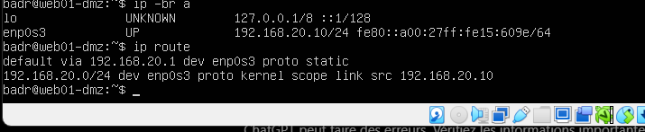

# Lesson 1 — Build the lab and understand each step

## 1. Create three network zones

A **LAN** contains the client. A **DMZ** contains a server that should have limited access to the LAN. The **WAN** connects the firewall to its upstream network.

In VirtualBox, FW01-pfSense uses adapter 1 in NAT mode, adapter 2 on Internal Network `FW-LAN`, and adapter 3 on Internal Network `FW-DMZ`. Kali uses FW-LAN and Ubuntu uses FW-DMZ. Separate networks force inter-zone traffic through pfSense.

The host has 16 GB RAM. pfSense and Ubuntu were configured with 2 GB RAM each. Two vCPUs and 20 GB disks were requested; these hardware values were not all independently audited. Kali is a linked clone, so retain its original base disk.

## 2. Install pfSense and configure interfaces

pfSense CE 2.9.0-RELEASE amd64 was installed. At the console, em0 became WAN, em1 LAN, and em2 DMZ. These are operating-system names for the virtual network cards.

Under **Interfaces**, assign LAN 192.168.1.1/24 and DMZ 192.168.20.1/24. WAN uses DHCP and obtained 10.0.2.15/24 via gateway 10.0.2.2. DMZ has no upstream gateway selected and IPv6 configuration is None. Private/bogon blocking was unchecked on the internal DMZ interface.

The LAN DHCP service allocates .100–.199. Kali obtained 192.168.1.100. From Kali, open `https://192.168.1.1`, accept the known lab firewall certificate, sign in, and change the initial admin password. The **Dashboard** summarizes service and interface status; interface details show addresses and link status.

## 3. Install the Ubuntu DMZ server

Ubuntu Server was installed from the 22.04.5 live-server AMD64 ISO. Set hostname `web01-dmz`, account `badr`, and keep the password private. On enp0s3, configure 192.168.20.10/24, gateway 192.168.20.1 and DNS 1.1.1.1. Leave the proxy blank because this lab has no proxy.

The mirror check initially failed to resolve a name, so installation continued from the ISO. Remove installation media when requested and reboot. Verify:

```bash
ip -br a
ip route
```



## 4. Apply the firewall policy

Follow [the ordered rule tables](firewall-policy.md). Use **Save**, then **Apply Changes**. The DMZ rules permit DNS and outbound web traffic while blocking LAN and firewall destinations. The LAN rules permit web access and, later, SSH from Kali.

Check DNS on Ubuntu:

```bash
resolvectl query archive.ubuntu.com
```

The successful answer was captured. A previous query used `archive.ubunto.com`, a spelling error; correct the hostname before diagnosing the network.

## 5. Install Nginx and test HTTP

Nginx is the web server: it listens for requests and returns the site's files. On Ubuntu:

```bash
sudo apt update
sudo apt install nginx -y
systemctl status nginx --no-pager
curl -I http://localhost
```

`apt update` refreshes package lists; it is not a full system upgrade. Nginx was active and enabled. The local HTTP response was 200 OK. From Kali:

```bash
curl -I --connect-timeout 5 http://192.168.20.10
```

A 200 response confirms the web service is reachable from the LAN. HTTP was used first to establish a simple baseline before adding TLS.

## 6. Enable SSH administration

Typing long commands in the VirtualBox server console was inconvenient. SSH lets Kali open an encrypted remote shell on Ubuntu and use its graphical terminal's paste function.

On Ubuntu:

```bash
sudo apt update
sudo apt install openssh-server -y
sudo systemctl enable --now ssh
systemctl status ssh --no-pager
```

Add the LAN rule from Kali 192.168.1.100 to WEB01 192.168.20.10, TCP destination 22, source port Any, above the LAN-to-DMZ block. From Kali:

```bash
ssh badr@192.168.20.10
```

For first-time connections, verify the displayed host-key fingerprint against the Ubuntu console before accepting it. For an ED25519 key, the console command is `ssh-keygen -lf /etc/ssh/ssh_host_ed25519_key.pub`. This check was advised, but fingerprint comparison was not captured in the evidence. Login itself was confirmed.

A prompt such as `badr@web01-dmz:~$` means commands execute on Ubuntu, even though the window is on Kali. `exit` returns to Kali. Paste in the Kali terminal with Ctrl+Shift+V (host-to-guest clipboard integration must also work, or copy from within Kali).

## 7. Create the TLS certificate

TLS encrypts the web connection. A certificate identifies the server; its private key stays on Ubuntu. This lab uses a self-signed certificate with the IP and hostname in Subject Alternative Name.

Run on Ubuntu, including through SSH:

```bash
sudo openssl req -x509 -nodes -days 365 -newkey rsa:2048 -keyout /etc/ssl/private/web01-dmz.key -out /etc/ssl/certs/web01-dmz.crt -subj "/CN=web01-dmz" -addext "subjectAltName=IP:192.168.20.10,DNS:web01-dmz"
sudo chmod 600 /etc/ssl/private/web01-dmz.key
```

`-x509` creates the self-signed certificate, `-days 365` sets its validity and `-nodes` leaves the key without a passphrase so the service can start unattended. File permission 600 restricts key access to its owner, root. Never commit the key to GitHub.

## 8. Configure Nginx HTTPS

Open the configuration with `sudo nano /etc/nginx/conf.d/web01-https.conf` and enter the following block once:

```nginx
server {
    listen 443 ssl;
    server_name 192.168.20.10 web01-dmz;

    ssl_certificate /etc/ssl/certs/web01-dmz.crt;
    ssl_certificate_key /etc/ssl/private/web01-dmz.key;
    ssl_protocols TLSv1.2 TLSv1.3;

    root /var/www/html;
    index index.nginx-debian.html index.html;
}
```

`listen` selects the port, the certificate directives select the TLS files, and `root`/`index` select the existing welcome page. Indentation helps readability; braces and semicolons matter to syntax. Save with Ctrl+O, Enter, then exit with Ctrl+X.

```bash
sudo nginx -t
```

Only after a successful test:

```bash
sudo systemctl reload nginx
```

The first test failed because the certificate path did not exist. Creating the certificate at the expected path resolved the error. The subsequent syntax and configuration test succeeded.

## 9. Validate HTTPS and certificate trust

From Kali, the first diagnostic test used:

```bash
curl -k -I --connect-timeout 5 https://192.168.20.10
```

This returned 200 OK. `-k` skips certificate authentication; encryption alone does not verify server identity. Next, copy the public certificate over SSH and trust it explicitly for this request:

```bash
scp badr@192.168.20.10:/etc/ssl/certs/web01-dmz.crt ~/web01-dmz.crt
curl --cacert ~/web01-dmz.crt -I --connect-timeout 5 https://192.168.20.10
```

The operator confirmed 200 OK without `-k`. This checks certificate validity and the requested IP against the supplied trust file. It does not install global browser trust, and safe trust bootstrapping depends on authenticating the SSH endpoint.

## 10. Validate isolation, logs and Internet access

Use [the validation table](validation.md). **Status > System Logs > Firewall** identifies blocked packets by interface, source, destination, protocol and rule. Correlate each negative test with its matching log. **Firewall > NAT > Outbound** shows address translation; automatic rules cover both lab networks.

Ubuntu's `curl -I --connect-timeout 5 --max-time 15 https://example.com` returned 200 OK according to the operator. The core build is complete; optional extensions are separated from completed results.

## Troubleshooting lessons

- Kali initially retained an address from another lab. Removing stale static NetworkManager settings and re-enabling DHCP restored the correct subnet.
- Correct a DMZ /32 mask to /24 and the mistaken server gateway .10.1 to .20.1.
- Check rule order before adding broader permissions.
- A malformed ping command proves nothing about connectivity; use `ping -c 4 -W 2 ADDRESS`.
- Missing certificate files cause `nginx -t` to fail; fix the file/path before reloading.

## Reference documentation

- [pfSense firewall rules](https://docs.netgate.com/pfsense/en/latest/firewall/rule-methodology.html)
- [Nginx HTTPS configuration](https://nginx.org/en/docs/http/configuring_https_servers.html)
- [OpenSSL req](https://docs.openssl.org/3.0/man1/openssl-req/)
- [curl certificate verification](https://curl.se/docs/sslcerts.html)
