# Evidence index

Real screenshots copied without alteration from the lab walkthrough. Diagrams are explanations, not test evidence. No synthetic terminal or firewall screenshots are used.

## LAN HTTP 200 and blocked ping

Capture: `20261029-163528`.

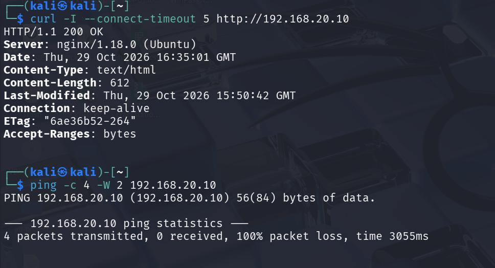

## LAN rule matching the ICMP blocks

Capture: `20261029-163943`.

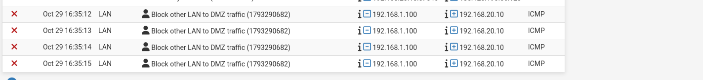

## Successful DNS resolution

Capture: `20261029-151307`.

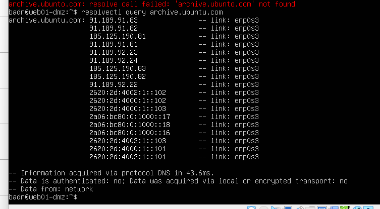

## DMZ-to-LAN ICMP blocks

Capture: `20261101-153119`.

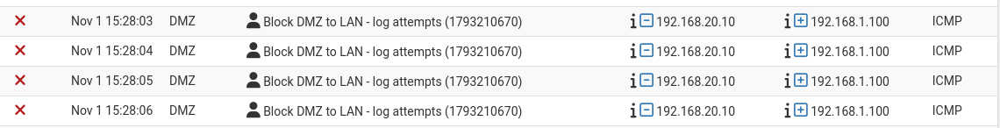

## Timeout reaching firewall HTTPS

Capture: `20261101-153411`.

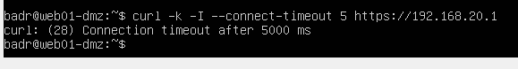

## Firewall-self rule blocking TCP SYN

Capture: `20261101-153645`.

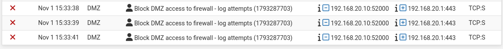

## SSH active, enabled and listening on 22

Capture: `20261101-162916`.

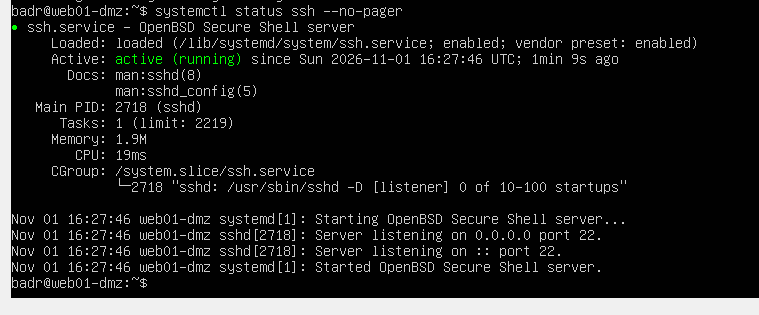

## LAN rules saved, before Apply Changes

Capture: `20261101-163557`.

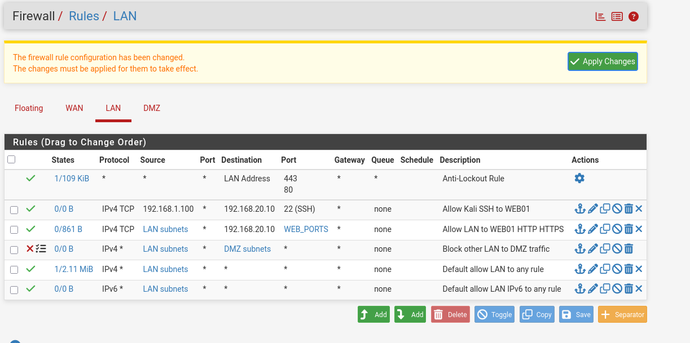

## Nginx configuration test successful

Capture: `20261101-164659`.

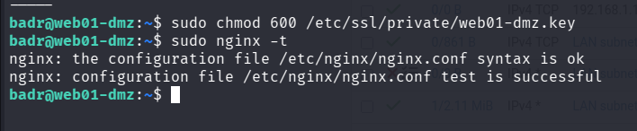

## Automatic NAT for LAN and DMZ

Capture: `20261101-165031`.

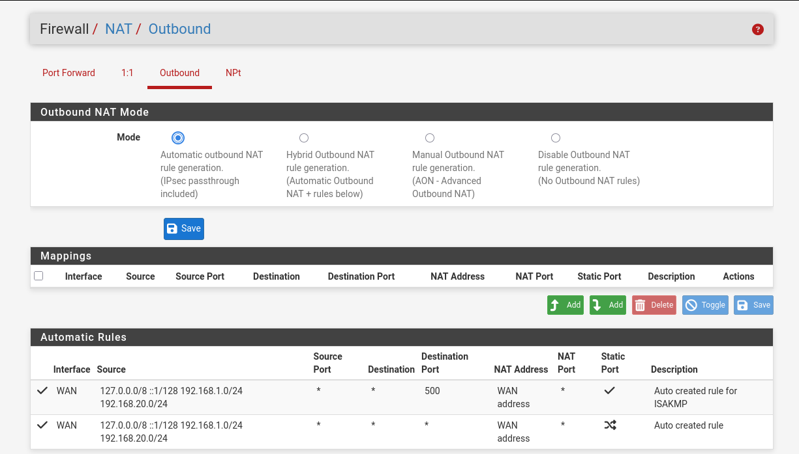

## Final applied DMZ policy

Capture: `20261101-165228`.

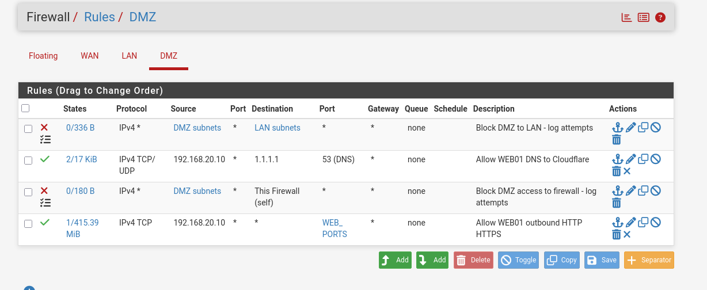

## Nginx active/enabled

Capture: `20261029-155207`.

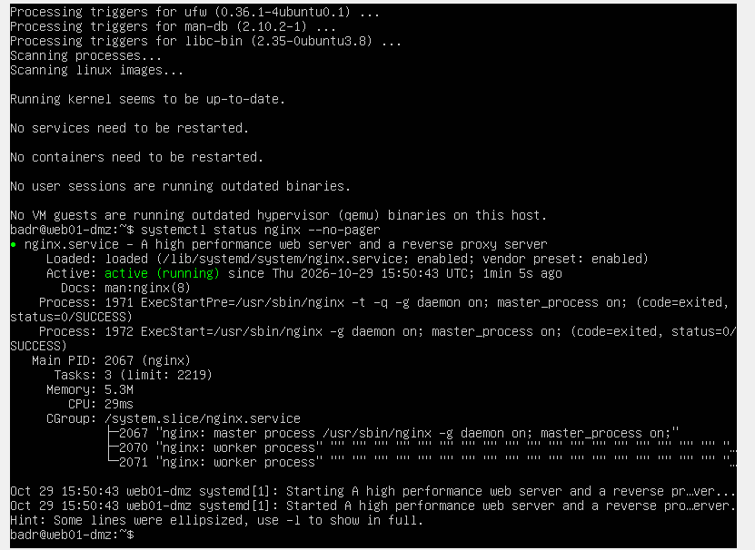

## Local HTTP 200

Capture: `20261029-155333`.

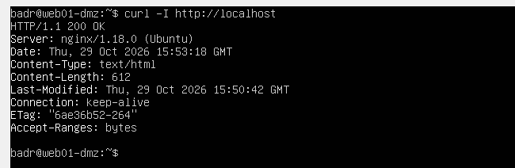

## Earlier installation evidence

- [Ubuntu installation](../assets/ubuntu-installed.png)
- [Ubuntu IP and route](../assets/ubuntu-network.png)
- [Initial mirror DNS failure](../assets/mirror-dns-failure.png)

The original `architecture.png` and `traffic-policy.png` are historical illustrations from the infrastructure checkpoint; the latter describes a then-planned policy. Use the current README and final policy tables instead.

HTTPS 200 with `--cacert`, SSH login, and outbound HTTPS 200 were confirmed by the operator in text. Their exact successful output was not supplied as an image and has not been fabricated. The LAN SSH rule image retains its pending-apply banner; the later login confirmation is separate evidence.
