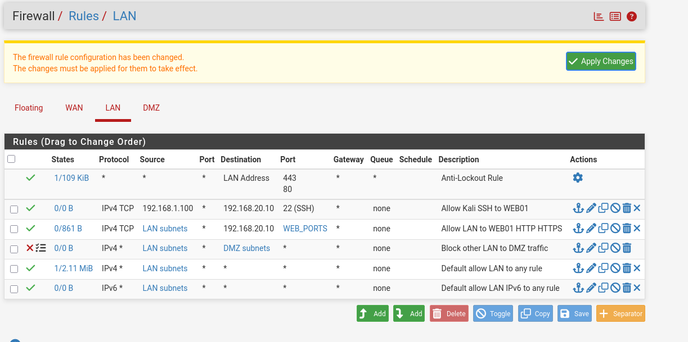
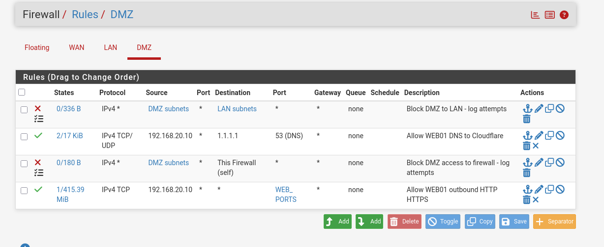
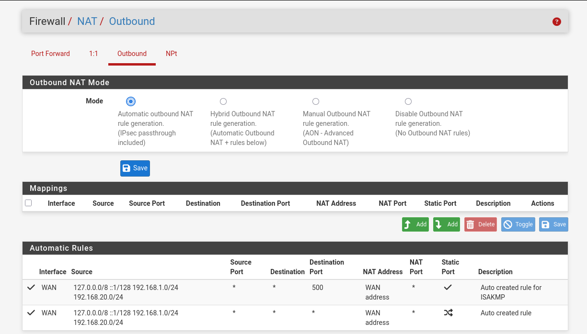

# Lesson 2 — Firewall policy and order

## How to read a rule

The source starts the connection. The destination receives it. The destination port identifies the service, such as SSH 22 or HTTPS 443. Client source ports are normally temporary, so our source port fields are Any.

For this lab's ordinary interface rules, place exceptions above broader blocks: a new connection is evaluated on the interface where it enters pfSense, from top to bottom. Replies belonging to an allowed connection use firewall state. That is why WEB01 can reply to a LAN web request even though new DMZ-to-LAN connections are blocked.

## LAN — Firewall > Rules > LAN

| Order | Action | Protocol | Source | Destination | Destination port | Purpose |
|---|---|---|---|---|---|---|
| 1 | Pass (automatic) | As shown by pfSense | Any | LAN address | 80/443 | Anti-lockout management access |
| 2 | Pass | IPv4 TCP | 192.168.1.100 | 192.168.20.10 | 22 | Kali SSH administration |
| 3 | Pass | IPv4 TCP | LAN subnets | 192.168.20.10 | WEB_PORTS | Web access |
| 4 | Block + log | IPv4 any | LAN subnets | DMZ subnets | Any | Block other LAN-to-DMZ traffic |
| 5 | Pass | IPv4 any | LAN subnets | Any | Any | Existing default LAN allow |
| 6 | Pass | IPv6 any | LAN subnets | Any | Any | Existing default IPv6 allow; not validated |

`WEB_PORTS` is a Ports alias containing **two individual entries: 80 and 443**, not the continuous range 80–443. Configure it under **Firewall > Aliases > Ports** so the same service group can be reused.

This screenshot was taken after saving the SSH rule but **before Apply Changes** (the yellow banner is visible). Subsequent SSH login was confirmed by the operator. Saving stores the edit; applying activates it.

Originally, the LAN-to-DMZ block was below the default allow rule. Moving it above the default allow made the intended restriction effective. Keep both the web and SSH exceptions above that block.

## DMZ — Firewall > Rules > DMZ

| Order | Action | Protocol | Source | Destination | Destination port | Description |
|---|---|---|---|---|---|---|
| 1 | Block + log | IPv4 any | DMZ subnets | LAN subnets | Any | Block DMZ to LAN - log attempts |
| 2 | Pass | IPv4 TCP/UDP | 192.168.20.10 | 1.1.1.1 | 53 | Allow WEB01 DNS to Cloudflare |
| 3 | Block + log | IPv4 any | DMZ subnets | This Firewall (self) | Any | Block DMZ access to firewall - log attempts |
| 4 | Pass | IPv4 TCP | 192.168.20.10 | Any | WEB_PORTS | Allow WEB01 outbound HTTP HTTPS |

All source ports are Any. No general DMZ allow rule was added. Logging is enabled on the two explicit blocks.

**Why these destinations?** The server needs DNS to resolve names and web access for package retrieval. It does not need to initiate connections into the LAN or administer the firewall. `This Firewall (self)` matches traffic addressed to pfSense, not ordinary traffic merely routed through it.

**Why this order?** The broad web egress rule could also match HTTPS to an internal host or firewall. Earlier blocks take precedence. This design blocks LAN and firewall destinations, but does not explicitly exclude every other private network upstream.

## NAT — Firewall > NAT > Outbound

Automatic mode includes both 192.168.1.0/24 and 192.168.20.0/24 and translates their outbound source addresses to the WAN address. Empty manual Mappings is normal in this mode. The extra port 500 rule is an automatically generated IPsec-related rule; we did not deploy an IPsec VPN.

NAT translates addresses; it does not replace the firewall policy. Between LAN and DMZ, pfSense routes traffic using the original addresses. Internet-bound traffic also passes through VirtualBox's upstream NAT.
